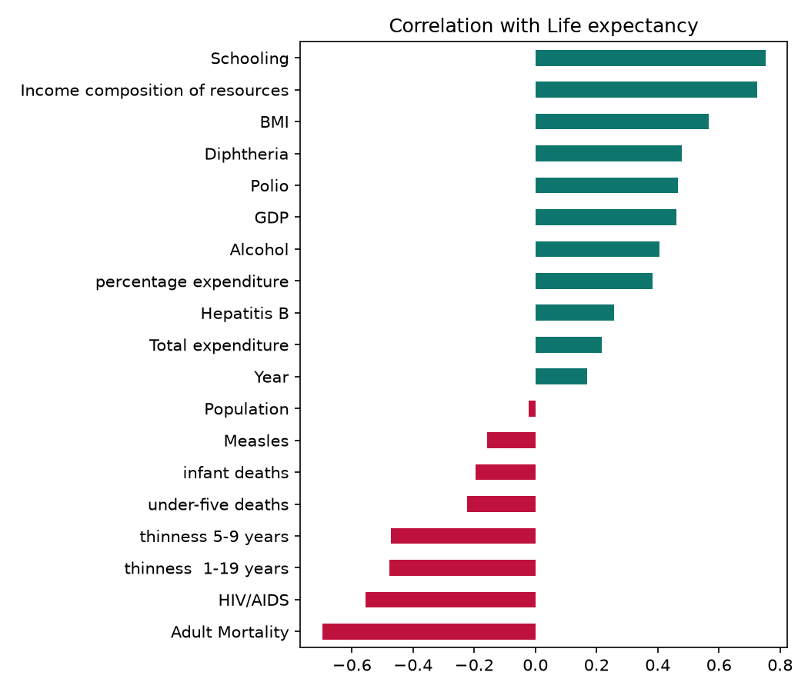
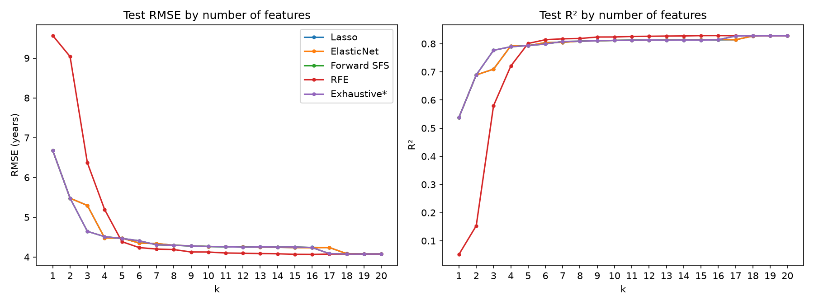
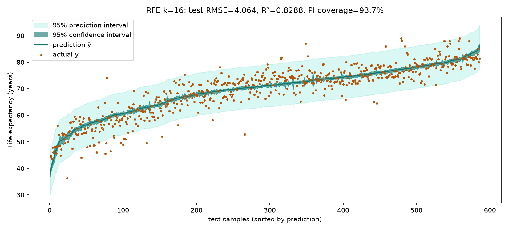
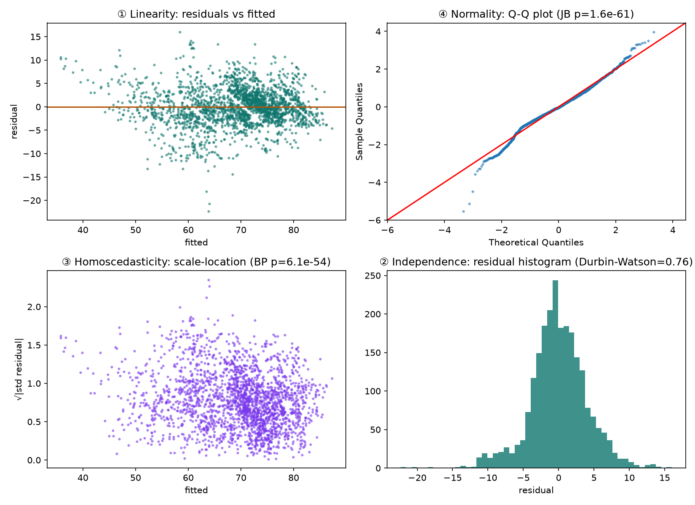
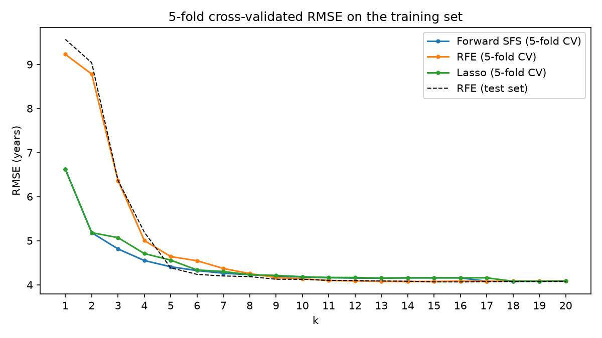
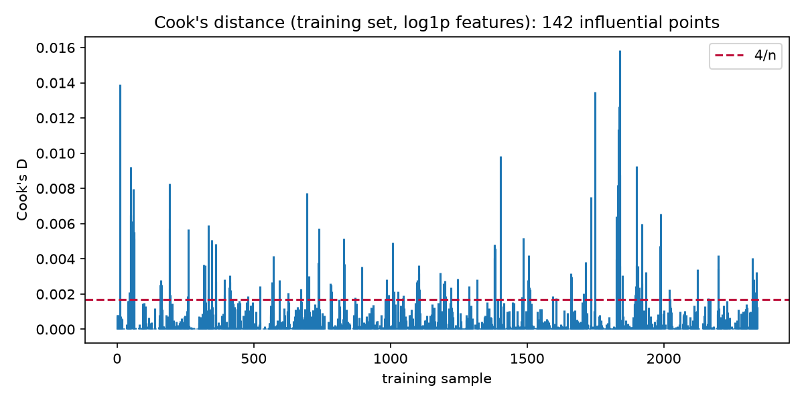
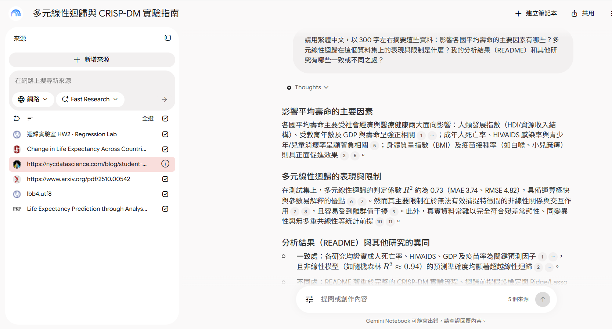

# HW2 — Multiple Linear Regression：預測各國平均壽命

物聯網應用與資料分析 HW2 · 依 CRISP-DM 流程完成多元線性迴歸、特徵選擇與模型評估。

- **Web（GitHub Pages）**：<https://ollyye16.github.io/AIoT-HW2-MultipleLR/>　· 資訊圖表：<https://ollyye16.github.io/AIoT-HW2-MultipleLR/infographic.html>
- **資料集**：[Life Expectancy (WHO) — Kaggle, kumarajarshi](https://www.kaggle.com/datasets/kumarajarshi/life-expectancy-who)（2,938 筆 × 22 欄，20 個可用特徵）
  - repo 內副本：[`data/Life_Expectancy_Data.csv`](data/Life_Expectancy_Data.csv)（SHA-256 `872125dd…87963b11`，與 Kaggle 原檔相同）

**網頁功能（加分項）**
- ✅ 下拉選單切換 problem：Life Expectancy (WHO)、50 Startups、Boston Housing
- ✅ 可貼上任意 CSV 網址當資料集，自動辨識數值/類別欄位、處理缺值
- 5 種特徵選擇方法 × k = 1…p 比較、係數檢定、**95% 信賴區間 / 預測區間圖**、五大假設檢定、即時預測

---

## 三句話看懂

1. **問題**：拿一個國家的資料（教育年數、成人死亡率、HIV 比例……共 20 個因素），猜這個國家的人平均能活幾歲。
2. **結果**：用 16 個因素最準，**平均猜錯約 4.06 歲**，能解釋 83% 的差異；只用 4 個因素也有 79%。
3. **關鍵**：**教育和收入**讓人活得久，**成人死亡率和 HIV** 讓人活得短；把 GDP、人口這類差距極大的數字取 log，誤差還能再降 **11%**。

## 一張表看完

| 步驟 | 白話說法 | 結果 |
|---|---|---|
| 建模型 | 每個因素乘一個權重，全部加起來 = 預測壽命 | 多元線性迴歸（OLS） |
| 挑因素 | 20 個因素不一定都要用，試試用幾個最準 | 16 個最準；4 個就差不多 |
| 準不準 | 拿模型沒看過的 586 筆資料考它 | 平均猜錯 4.06 歲，R² 0.83 |
| 範圍 | 不只給一個數字，還給「可能範圍」 | 約 ±8 歲，94% 實際值落在範圍內 |
| 健康檢查 | 線性迴歸有五個前提，資料符不符合？ | 五個都不完全符合 → 預測可用，範圍要保守看 |
| 改進 | 偏態數字取 log、刪離群點、換 Ridge/Lasso | 只有取 log 有效：4.07 → 3.62 歲 |

---

## 1. Business Understanding（商業理解）

> **一句話：** 找出哪些因素最能影響平均壽命，讓政府知道預算該先花在哪。

- **目標**：用各國每年的健康、經濟、社會指標，預測該年的平均壽命（`Life expectancy`，單位：歲）。
- **問題類型**：預測一個連續數字 → 多元線性迴歸。
- **成功標準**：測試集 R² > 0.8，而且係數要能解釋（哪些因素讓壽命變長、變短）。

## 2. Data Understanding（資料理解）

> **一句話：** 2,938 筆資料（193 國 × 16 年）、20 個因素；和壽命最相關的是**教育（+）**和**成人死亡率（−）**。

| 最強正相關 | r | 最強負相關 | r |
|---|---|---|---|
| Schooling（教育年數） | 0.752 | Adult Mortality（成人死亡率） | −0.696 |
| Income composition（收入組成指數） | 0.725 | HIV/AIDS | −0.557 |
| BMI | 0.568 | thinness 1-19 years（青少年過瘦率） | −0.477 |

r 介於 −1 ~ 1，越接近 ±1 關係越強。

<details>
<summary>▸ 展開看細節：欄位清單、缺值、共線性</summary>

| 項目 | 內容 |
|---|---|
| 筆數 | 2,938（193 個國家 × 2000–2015 年） |
| 目標 y | `Life expectancy`（10 筆缺值） |
| 特徵 | 20 個：`Year`、`Status`（開發中/已開發）、`Adult Mortality`、`infant deaths`、`Alcohol`、`percentage expenditure`、`Hepatitis B`、`Measles`、`BMI`、`under-five deaths`、`Polio`、`Total expenditure`、`Diphtheria`、`HIV/AIDS`、`GDP`、`Population`、`thinness 1-19 years`、`thinness 5-9 years`、`Income composition of resources`、`Schooling` |
| 不使用 | `Country`（193 個類別，屬於識別欄位） |

- **缺值**最多的欄位：Population 652、Hepatitis B 553、GDP 448、Total expenditure 226、Alcohol 194。
- `infant deaths` 與 `under-five deaths` 幾乎完全共線（VIF ≈ 200），`thinness 1-19` 與 `thinness 5-9` 也高度相關。



</details>

## 3. Data Preparation（資料準備）

> **一句話：** 刪掉沒有答案的 10 筆、補上缺值、把文字轉成數字，再切 20% 當「期末考」（測試集），訓練時完全不看。

<details>
<summary>▸ 展開看細節：六個步驟</summary>

1. **欄名清理**：原始欄名有前後空白（如 `"Life expectancy "`），全部 trim。
2. **刪除目標缺值**：`Life expectancy` 缺值的 10 筆刪除 → 2,928 筆。
3. **切分**：固定亂數種子（seed = 42）隨機切 80% 訓練（2,342 筆）/ 20% 測試（586 筆）。
4. **缺值補值**：用**訓練集的中位數**補（共 2,513 格），測試集也用訓練集的中位數，避免資料洩漏。
5. **類別編碼**：`Status` 做 one-hot，以 `Developed` 為基準，產生 `Status_Developing`。
6. **標準化**：只用在 Lasso / ElasticNet / RFE 的特徵排序；最終 OLS 模型使用原始單位，係數才好解釋。

</details>

## 4. Modeling（建模）

> **一句話：** 用 5 種方法挑因素，每種都試 1～20 個；**RFE 挑 16 個時最準**。

| 方法 | 白話做法 |
|---|---|
| Lasso | 慢慢放寬限制，看因素「進場」的先後順序 |
| ElasticNet | 同上，但限制方式混合 L1 + L2 |
| Forward SFS | 從 0 個開始，每次加入最能降低誤差的那個 |
| RFE | 從 20 個開始，每次踢掉最不重要的那個 |
| Exhaustive | 窮舉所有組合；20 個因素有 2²⁰ 種，太多，改用 Forward 結果 |



<details>
<summary>▸ 展開看細節：實作函式</summary>

模型：**OLS 多元線性迴歸**（statsmodels）。特徵選擇只用訓練集。Lasso 用 `sklearn.linear_model.lasso_path`、ElasticNet 用 `enet_path`（l1_ratio = 0.5）、RFE 用 `sklearn.feature_selection.RFE`（依標準化係數大小移除）。

</details>

## 5. Evaluation（評估）

> **一句話：** 平均猜錯 **4.06 歲**、R² 0.83；給出的 ±8 歲範圍有 94% 猜中。五個前提都不完全符合，所以預測可用，但範圍要保守看。

| 方法 | 最佳 k | RMSE（歲） | R² |
|---|---|---|---|
| **RFE** | **16** | **4.064** | **0.8288** |
| Forward SFS | 18 | 4.073 | 0.8281 |
| Lasso | 19 | 4.073 | 0.8281 |
| ElasticNet | 19 | 4.073 | 0.8281 |

RMSE = 平均猜錯多少歲（越低越好）；R² = 能解釋多少比例的差異（越接近 1 越好）。

**預測圖（95% 信賴區間 + 預測區間）**



- 深色帶 = **信賴區間（CI）**：「平均」壽命的範圍，很窄。
- 淺色帶 = **預測區間（PI）**：「單一國家某年」的範圍，約 ±8 歲。
- 549 / 586 = **93.7%** 實際值落在 PI 內，接近理論值 95%。區間外的點大多是低壽命國家，模型對它們有**高估**的情形。

<details>
<summary>▸ 展開看細節：Adj. R²、MAE、精簡模型、係數解讀</summary>

| 方法 | 最佳 k | RMSE | R² | Adj. R² | MAE |
|---|---|---|---|---|---|
| RFE | 16 | 4.064 | 0.8288 | 0.8240 | 3.046 |
| Forward SFS | 18 | 4.073 | 0.8281 | 0.8227 | 3.051 |
| Lasso | 19 | 4.073 | 0.8281 | 0.8223 | 3.052 |
| ElasticNet | 19 | 4.073 | 0.8281 | 0.8223 | 3.052 |

- **邊際效益遞減**：Forward SFS 只用 4 個特徵（Schooling、Adult Mortality、HIV/AIDS、Diphtheria）就有 RMSE 4.511、R² 0.789。再加 12 個特徵，RMSE 只再降 0.45 歲。
- **共線性會誤導 RFE**：`infant deaths` 和 `under-five deaths` 高度共線，係數被放大成一正一負，所以 RFE 最先保留它們，導致 k = 1、2 時 RMSE 高達 9.6、9.0。但兩者一起放進完整模型時確實有用。
- **最佳模型係數**（[`figures/best_model_coefficients.csv`](figures/best_model_coefficients.csv)）：Schooling（+0.65 歲/年）、收入組成指數（+4.76）、BMI、疫苗接種率（Diphtheria、Polio）為正向；成人死亡率、HIV/AIDS（−0.44）、開發中國家（−1.75 歲）為負向。Alcohol 與 Total expenditure 不顯著（p ≈ 0.16）。

</details>

### 5.1 健康檢查：迴歸五大假設

> **一句話：** 五個前提都不完全符合。點估計（哪些因素讓壽命變長/變短）仍可信，但 p 值與預測範圍偏樂觀。

| # | 前提 | 白話意思 | 結果 |
|---|---|---|---|
| ① | 線性 | 因素和壽命是直線關係 | ⚠ 還有彎曲的部分 |
| ② | 獨立 | 每筆誤差互不影響 | ⚠ 同一國家 16 年的誤差彼此相關 |
| ③ | 同變異 | 誤差大小到處差不多 | ⚠ 低壽命國家誤差較大 |
| ④ | 常態 | 誤差呈鐘形分布 | ⚠ 尾巴偏厚 |
| ⑤ | 無共線性 | 因素之間不要太像 | ⚠ 嬰兒死亡數 ≈ 五歲以下死亡數 |

<details>
<summary>▸ 展開看細節：檢定方法、統計量、解讀</summary>

最佳模型，訓練集殘差，α = 0.05：

| # | 假設 | 檢定 | 結果 |
|---|---|---|---|
| ① | 線性 | Ramsey RESET（加入 ŷ²） | p < 0.0001 |
| ② | 誤差獨立 | Durbin-Watson | DW = 0.76（理想值 ≈ 2） |
| ③ | 同變異 | Breusch-Pagan | LM = 298.2，p < 0.0001 |
| ④ | 殘差常態 | Jarque-Bera / Shapiro-Wilk | JB = 280.0，p < 0.0001；偏態 −0.21、峰態 4.64 |
| ⑤ | 無嚴重共線性 | VIF | 最大 200.8（infant deaths ↔ under-five deaths） |



- **②獨立**：資料依「國家 → 年份」排序，同一個國家連續 16 年的誤差彼此相關（某國被高估，往往每年都被高估），所以 DW 遠低於 2。這是 panel data 的特性；更嚴謹的做法是用國家固定效果或 cluster-robust 標準誤。
- **③同變異**：預測壽命 < 65 歲的國家殘差標準差 4.6–5.3 歲，> 72 歲只有 3.1–3.3 歲。
- **④常態**：Q-Q 圖中段貼近直線，偏離集中在左尾（少數嚴重高估的國家）。樣本數 2,342 很大，檢定對小偏離也很敏感。
- 網頁上每選一個模型都會即時重新檢定（JS 與 statsmodels 數值一致）。

</details>

### 5.2 能不能更好？三種改進嘗試

> **一句話：** 只有「取 log」有效（誤差 4.07 → 3.62 歲，−11%）；刪離群點和 Ridge/Lasso 都沒幫助。

| 嘗試 | 白話做法 | 測試 RMSE | 有沒有用 |
|---|---|---|---|
| 原始（全部 20 個因素） | — | 4.074 | 基準 |
| **取 log** | 把 GDP、人口這類差距極大（中位數 147 萬、最大 12.9 億）的數字壓小 | **3.619** | ✅ −11% |
| 取 log + 刪離群點 | 再刪掉 142 筆影響力特別大的資料 | 3.636 | ❌ 略差，所以不刪 |
| Ridge | 限制權重不要太大 | 4.077 | ❌ 差不多 |
| Lasso | 限制權重，並讓不重要的變 0 | 4.091 | ❌ 差不多 |

Ridge/Lasso 沒用的原因：資料有 2,342 筆、因素只有 20 個，模型本來就不會「想太多」（過度擬合）。

<details>
<summary>▸ 展開看細節：交叉驗證、正則化 α、Cook's distance</summary>

**5-fold 交叉驗證：最佳 k 穩不穩？**



- CV 曲線和測試集曲線形狀一致：k = 1→5 快速下降，之後趨於平緩。RFE 從 k = 12 起 CV RMSE 都在 4.07–4.09 之間；Forward SFS 與 Lasso 在 k = 13–16 約 4.15，要到 k ≥ 17–18 才降到 4.08。
- RFE 的 CV 最低點在 k = 15（4.074），測試集最低點在 k = 16（4.064），只差 0.01 歲 → k = 16 不是靠運氣選到的。

**OLS vs Ridge vs Lasso**

| 模型 | 測試 RMSE | MAE | MSE | R² | 5-fold CV RMSE | α（CV 選擇） |
|---|---|---|---|---|---|---|
| OLS（RFE k = 16） | 4.064 | 3.046 | 16.52 | 0.8288 | 4.081 | — |
| OLS（全部 20 個） | 4.074 | 3.053 | 16.60 | 0.8280 | 4.086 | — |
| Ridge（全部 20 個） | 4.077 | 3.054 | 16.62 | 0.8277 | 4.085 | 0.349 |
| Lasso（全部 20 個） | 4.091 | 3.061 | 16.73 | 0.8266 | 4.087 | 0.0067 |

交叉驗證選出的 α 都很小，Lasso 也保留了全部 20 個係數。

**log 轉換 + 影響點**

| 版本 | 訓練筆數 | 測試 RMSE | 改善 | R² |
|---|---|---|---|---|
| ① 原始特徵（全部 20 個） | 2,342 | 4.074 | — | 0.8280 |
| ② 對偏態特徵取 log1p | 2,342 | 3.619 | −11.2% | 0.8643 |
| ③ log1p + 移除 Cook's D > 4/n | 2,200 | 3.636 | −10.7% | 0.8630 |

- 偏態 > 2 的 10 個特徵：GDP、Population、HIV/AIDS、percentage expenditure、Measles、infant/under-five deaths、Hepatitis B、Polio、Diphtheria（Population 偏態 17.9）。
- Cook's distance 找出的 142 個影響點，移除後測試 RMSE 反而略差，沒有證據顯示它們是資料錯誤，所以不刪除。



</details>

### 5.3 實作時踩到的坑

> **一句話：** 數字大小差太多（人口 ~10⁹ vs 比例 0–1）會讓 scikit-learn 算錯，**先標準化**就好。

<details>
<summary>▸ 展開看細節</summary>

一開始用 scikit-learn 的 `LinearRegression` 直接擬合全部 20 個原始特徵，測試 RMSE 是 6.80；同一個模型用 statsmodels 卻是 4.07。原因是 `Population`（~10⁹）和比例型特徵（0–1）尺度差太多，最小平方法把太小的奇異值當成 0 截掉，模型就悄悄變差。先標準化再擬合（數學上是同一個模型）就恢復成 4.07。教訓：不同工具的結果要交叉核對。

</details>

### 5.4 結論

1. **關鍵因素**：教育和收入讓人活得久；成人死亡率和 HIV/AIDS 讓人活得短；其他條件相同時，開發中國家約少 1.75 歲。
2. **模型表現**：平均猜錯 4.06 歲、R² 0.83；取 log 後進步到 3.62 歲、R² 0.86。
3. **精簡就夠用**：只用 4 個因素就有 R² 0.79，適合需要簡單解釋的場合。
4. **限制**：同一國家有 16 年資料（彼此相關）且誤差大小不一，p 值與範圍偏樂觀；未來可用固定效果模型或 cluster-robust 標準誤改善。

## 6. Deployment（部署）

> **一句話：** 打開網頁就能用，拉動滑桿即時預測壽命；有 Python 後端時自動改用 Python 計算。

| 檔案 | 說明 |
|---|---|
| `index.html` | 網頁前端（Chart.js）。後端連得到就用 Python 計算；連不到（GitHub Pages）時改用瀏覽器內 JavaScript，結果相同 |
| `app.py` | Flask 後端：`POST /api/analyze`，scikit-learn + statsmodels |
| `analysis.py` | 離線產生報告用的圖表與數據（`figures/`），包含五大假設、交叉驗證、Ridge/Lasso、log 轉換與 Cook's distance；`figures/advanced.json` 供網頁「評估」區使用 |
| `infographic.html` | 一頁式資訊圖表（[開啟](infographic.html)） |
| `api/index.py`、`vercel.json` | Vercel 部署設定（選用） |

```bash
pip install -r requirements.txt matplotlib
python app.py          # 開 http://localhost:5000/
python analysis.py     # 重新產生 figures/（需要 matplotlib）
```

---

## GPT 輔助內容

> TODO（同學自行填寫）：說明哪些部分有使用 ChatGPT / Claude 協助（例如程式撰寫、統計解釋），並附上對話 PDF 連結（pdfCrowd 匯出）。

## NotebookLM 摘要

用 NotebookLM 研究網路上同主題（WHO Life Expectancy）的解法。來源：本專案網頁、[RPubs 多元迴歸報告](https://rstudio-pubs-static.s3.amazonaws.com/671846_62635c28b95045bb984c75c87fb7d415.html)、[arXiv 2510.00542](https://www.arxiv.org/pdf/2510.00542)、[Stanford Intersect](https://ojs.stanford.edu/ojs/index.php/intersect/article/view/3445)、[iJOE](https://online-journals.org/index.php/i-joe/article/view/33315)（[NYC Data Science](https://nycdatascience.com/blog/student-works/life-expectancy-by-country/) 因網站阻擋未能匯入）。

> 提問：影響各國平均壽命的主要因素有哪些？多元線性迴歸在這個資料集上的表現與限制是什麼？我的分析結果和其他研究有哪些一致或不同之處？

**NotebookLM 回答（原文）**

**影響平均壽命的主要因素**
各國平均壽命主要受社會經濟與醫療健康兩大面向影響：人類發展指數（HDI/資源收入結構）、受教育年數及 GDP 與壽命呈強正相關；成年人死亡率、HIV/AIDS 感染率與青少年/兒童消瘦率呈顯著負相關；身體質量指數（BMI）及疫苗接種率（如白喉、小兒麻痺）則具正面促進效果。

**多元線性迴歸的表現與限制**
在測試集上，多元線性迴歸的判定係數 R² 約為 0.73（MAE 3.74、RMSE 4.82），具備運算極快與參數易解釋的優點。然而其主要限制在於無法有效捕捉特徵間的非線性關係與交互作用，且容易受到離群值干擾。此外，真實資料常難以完全符合殘差常態性、同變異性與無多重共線性等統計前提。

**分析結果與其他研究的異同**
- 一致處：各研究均證實成人死亡率、HIV/AIDS、GDP 及疫苗率為關鍵預測因子，且非線性模型（如隨機森林 R² ≈ 0.94）的預測準確度均顯著超越線性迴歸。
- 不同處：本專案著重於完整的 CRISP-DM 實驗流程、迴歸前提假設檢定與 Ridge/Lasso 正規化比較；而部分研究在預處理時直接剔除缺值率高於 5% 的欄位（如 GDP 與教育年數），導致特徵重要性排序與涵蓋完整 HDI 變數的研究產生差異。



**我的核對與心得**
- NotebookLM 寫的 R² 0.73、RMSE 4.82 是**其他研究**的線性迴歸結果；本專案是 R² 0.83、RMSE 4.06 歲（取 log 後 R² 0.86、RMSE 3.62）。差異可能來自缺值處理與特徵選擇方式不同。
- 「非線性模型更準」：本專案沒有訓練隨機森林，但結果方向一致——RESET 檢定顯示還有非線性，而對偏態特徵取 log（一種非線性轉換）讓誤差降了 11%。
- 因素方向完全一致：教育、收入組成（HDI 的一部分）為正向；成人死亡率、HIV/AIDS、消瘦率為負向。
- 本專案保留了缺值多的欄位（用訓練集中位數補值），所以 GDP 與 Schooling 都有進入模型，這是和「直接刪欄位」的研究不同之處。
